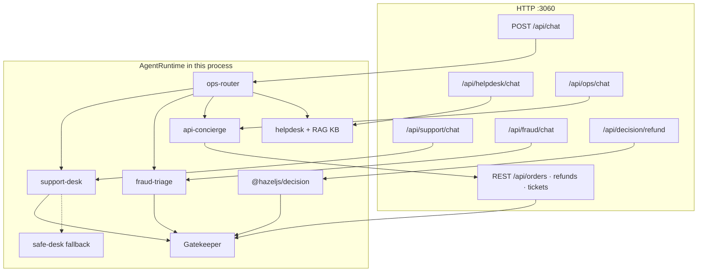
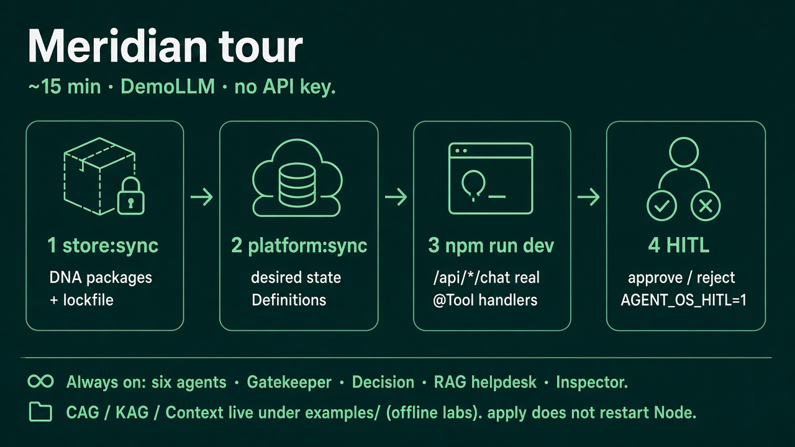
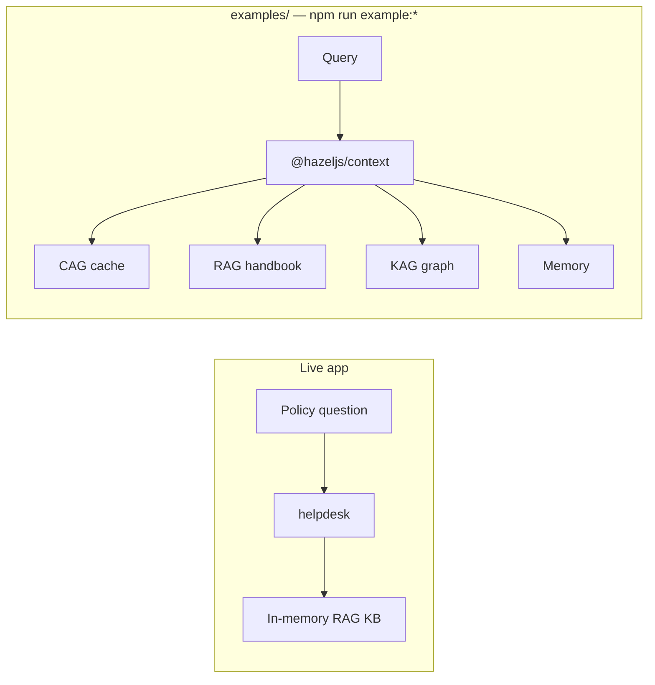
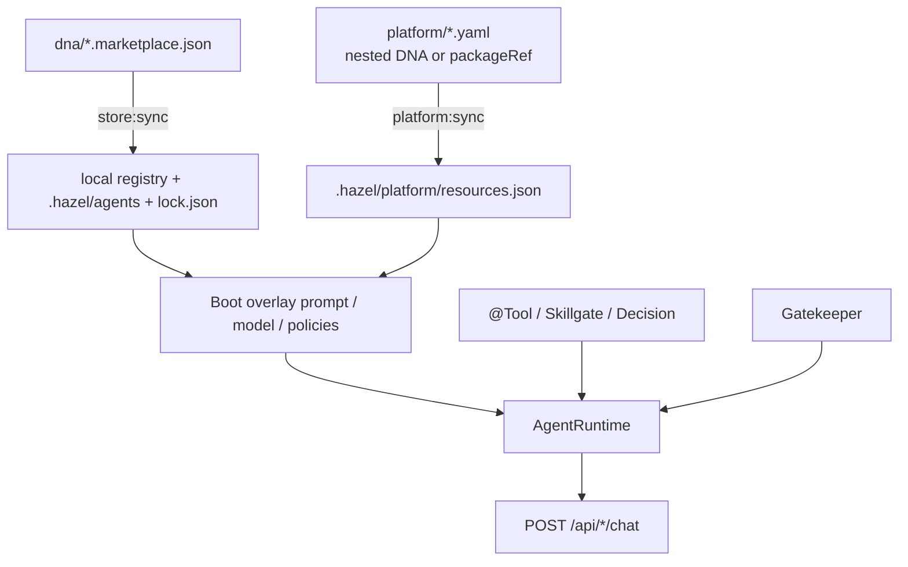

# Meridian Ops Platform

**Tagline:** HazelJS Agent OS flagship — ship AI workers as part of your TypeScript backend.

Canonical teaching app for [HazelJS Agent OS](https://hazeljs.ai/agent-os). One Nest-style Hazel process runs **six agents**, **Skillgate**, **Gatekeeper**, **Decision HITL**, **crash-safe refunds**, and a **RAG helpdesk**. DNA + Store + platform manifests sit beside that runtime (versioned like packages, declared like infrastructure). Offline **CAG / KAG / Context** labs live under [`examples/`](./examples/).

Not [Builder Methods Agent OS](https://hazeljs.ai/compare/builder-methods-agent-os), [Agno AgentOS](https://hazeljs.ai/compare/agno-agentos), or [agentos.sh](https://hazeljs.ai/compare/agentos-sh).

## What is in this repo

| Surface | Always on with `npm run dev` | Opt-in / separate |
| --- | --- | --- |
| Commerce agents + real `@Tool` handlers | Yes | — |
| Gatekeeper (default deny) + DNA overlay | Yes | `AGENT_OS_GATEKEEPER=0` / `AGENT_OS_DNA_OVERLAY=0` |
| Decision Runtime refunds | Yes (`/api/decision/*`) | — |
| RAG helpdesk (in-memory KB) | Yes (`POST /api/helpdesk/chat`) | — |
| Inspector UI | Yes (`http://localhost:3060/__hazel`) | — |
| HITL pauses (refund / freeze) | Demo auto-approves | `AGENT_OS_HITL=1` |
| Agent VM (effect types, speculate, undo) | — | `AGENT_OS_AGENT_VM=1` |
| SQL durable runs | File store default | `AGENT_OS_DURABLE_BACKEND=sql` |
| CAG / KAG / unified Context | — | `npm run example:*` (no HTTP server) |





## Quick start

```bash
cp -n .env.example .env
npm install
npm run store:sync      # publish 6 DNA → .hazel/agents + lock
npm run platform:sync   # apply manifests → .hazel/platform
npm run tour            # F1–F22 map + curls
npm run dev             # http://localhost:3060
```

Leave `OPENAI_API_KEY` empty (DemoLLM — no paid key). Set `AGENT_OS_HITL=1` for real approval pauses.

Boot log should show Skillgate report + `DNA overlay: …` + `Gatekeeper: enforce · deny · …` + `Decision Runtime: refund-approval`.

Open Inspector at [http://localhost:3060/__hazel](http://localhost:3060/__hazel).

### First curls

```bash
# Track an order (real lookupOrder tool)
curl -s localhost:3060/api/support/chat \
  -H 'content-type: application/json' \
  -d '{"message":"Where is my package for ORD-1001?"}' | jq '{agent, response, steps}'

# RAG helpdesk (policy KB — no money tools)
curl -s localhost:3060/api/helpdesk/chat \
  -H 'content-type: application/json' \
  -d '{"message":"What is the refund SLA?"}' | jq '{agent, response}'

# Router picks a specialist
curl -s localhost:3060/api/chat \
  -H 'content-type: application/json' \
  -d '{"message":"Track ORD-1001"}' | jq '{agent, steps}'
```

Full walkthrough: [TOUR.md](./TOUR.md).

## API map

| Method | Path | What it is |
| --- | --- | --- |
| POST | `/api/chat` | `ops-router` — default door, delegates |
| POST | `/api/support/chat` | `support-desk` — orders, tracking, refunds |
| POST | `/api/helpdesk/chat` | `helpdesk` — RAG policy FAQ |
| POST | `/api/ops/chat` | `api-concierge` — Skillgate REST skills |
| POST | `/api/fraud/chat` | `fraud-triage` — risk + HITL freeze |
| POST | `/api/approvals/:id/approve` · `/reject` | Resume Gatekeeper HITL |
| POST | `/api/decision/refund` | Closed-set refund judgment (always Decision HITL) |
| POST | `/api/decision/refund/:id/resume` | Override → Gatekeeper `payments.refund` |
| GET | `/api/decision/status` | Decision runtime ready? |
| GET | `/api/skillgate/report?json=1` | Include / deny skills |
| GET | `/api/gatekeeper/status` | Policies + mode |
| GET | `/api/agent-vm/status` | Effect typing (off until `AGENT_OS_AGENT_VM=1`) |
| GET | `/__hazel` | Inspector UI |
| GET | `/api/orders` · `/api/refunds` · `/api/tickets` | First-party REST (Skillgate source) |
| GET | `/api/catalog` | Public catalog — **not** a Skillgate skill |
| GET | `/health` | Health probe — **denied** as a skill unless `allowAdmin` |

## Agents

| Agent | Role | Tools / notes |
| --- | --- | --- |
| `ops-router` | Default `POST /api/chat` | Delegates to the four specialists |
| `support-desk` | Orders / tracking / refunds | `lookupOrder`, `trackShipment`, `processRefund` (approval) |
| `safe-desk` | Read-only fallback / twin | `lookupOrder` only |
| `helpdesk` | Policy FAQ | RAG over `src/rag/helpdesk-kb.ts` + `listKbTopics` |
| `api-concierge` | Ops over REST | Skills from Skillgate (`fromModule`), not hand-written `@Tool`s |
| `fraud-triage` | Risk + freeze | `getRiskSignals`, `freezeAccount` (approval) |

DNA packages: `dna/*.marketplace.json` — six marketplace packages after `store:sync`.

---

## Feature: Decision Runtime (refund judgments)

**Problem:** LLMs invent refund verbs; confidence gets treated as permission.  
**How Meridian does it:** `@hazeljs/decision` chooses from `approve | reject | review`, pauses for Decision HITL, then Gatekeeper authorizes `payments.refund`. Confidence never means permission.  
**Try:** `POST /api/decision/refund` → `POST /api/decision/refund/:decisionId/resume` (see `next` in the first response).  
**DNA:** `support-desk` declares `decisions.refund-approval`.  
**Not this:** Agent Office UI lives in [hazeljs-agent-office](https://github.com/hazel-js/hazeljs-agent-office) at `/office/decisions` — not in Meridian or Inspector.

## Feature: HITL refunds

**Problem:** Auto-refunds lose money when the model is wrong or the process restarts.  
**How Meridian does it:** `@hazeljs/agent-gatekeeper` requires approval on `processRefund` (default deny for unknown tools) + durableSuspend; approve via API.  
**Try:** `AGENT_OS_HITL=1` + `POST /api/support/chat` + `POST /api/approvals/:id/approve`.  
**Not this:** `hazel agent run` stubs — they don't move money.

## Feature: Agent Gatekeeper

**Problem:** PolicyEngine on the runtime is skipped once an authorization gate is set; in-memory audit/approvals do not survive a second replica.  
**How Meridian does it:** `authorizationGate` on AgentRuntime, durable HumanTask approvals, console JSON audit. Optional `GATEKEEPER_REDIS_URL` for multi-replica consume. MCP `tools/call` is wrapped with `protectMcpInvoke`.  
**Try:** `GET /api/gatekeeper/status` and `npm run gatekeeper:validate`.  
**Off:** `AGENT_OS_GATEKEEPER=0` falls back to PolicyEngine only.

## Feature: RAG helpdesk

**Problem:** Policy questions (“what is the refund SLA?”) should not hit order tools or invent IDs.  
**How Meridian does it:** `helpdesk` agent with `enableRAG` against an in-memory KB (`src/rag/helpdesk-kb.ts`). No refund / freeze tools.  
**Try:** `POST /api/helpdesk/chat` or ask the router a policy question.  
**Related:** the same KB idea as an offline script — `npm run example:rag`.

## Feature: Agent VM (effect types & speculation)

**Problem:** Agents try multiple plans in parallel; losing branches leak holds/refunds, and failed runs leave no undo story.  
**How Meridian does it:** `@hazeljs/agent-vm` classifies tools (`@Read`, `@Reversible`, `@Irreversible`). Support-desk refunds are reversible with `@Compensate`. Set `AGENT_OS_AGENT_VM=1` to wire `EffectGate` on `ToolExecutor`.  
**Try:** `GET /api/agent-vm/status` · `POST /api/agent-vm/speculate/travel` · `POST /api/agent-vm/runs/:runId/undo`.  
**Off:** default (`AGENT_OS_AGENT_VM` unset) — kernel runs without effect journaling.

---

## Context labs (RAG / CAG / KAG / Context)

The **live server** wires RAG on `helpdesk`. **CAG, KAG, and `@hazeljs/context` are not injected into AgentRuntime here** — they are offline TypeScript labs (no API keys, no `npm run dev`).



```bash
npm run example:install
npm run example:rag      # handbook retrieval (mirrors helpdesk KB)
npm run example:cag      # cached policy + tenant isolation
npm run example:kag      # settlement evidence path
npm run example:context  # auto planner over all four
```

Details: [examples/README.md](./examples/README.md) · post: [RAG vs CAG vs KAG](https://hazeljs.ai/blog/rag-vs-cag-vs-kag).

---

## DNA and platform — purpose

Meridian is a **normal TypeScript backend** (`npm run dev`). Chat, tools, HITL, Skillgate, and Decision all run inside that process.

DNA and the platform control plane sit **beside** that runtime. They answer different questions:

| Piece | Question it answers |
| --- | --- |
| **App code** (`@Agent` / `@Tool` / Skillgate) | What can this agent *do*? (orders DB, refunds, freezes) |
| **DNA** (`dna/*.marketplace.json`) | Who is this agent *as a package*? (name, prompt, tool names, policies, version) |
| **Store** (`store:sync`) | How do we *version and share* that package? (registry + `.hazel/agents` lock) |
| **Platform** (`platform:sync` / `hazel agent apply`) | What should *this environment* run? (Definitions / Deployments as desired state) |
| **Runtime** (`POST /api/chat`) | What happens *right now*? (steps, HITL, timeline) |
| **Gatekeeper** (`@hazeljs/agent-gatekeeper`) | May this agent call this tool *now*? (default deny, HITL, audit) |
| **Decision** (`@hazeljs/decision`) | Which closed-set *judgment* before a side effect? |
| **Agent VM** (`@hazeljs/agent-vm`, opt-in) | What *effect class* is this tool? Can we speculate and undo? |

**DNA ≠ implementation.** DNA lists tool *names* and policies; real side effects stay in TypeScript. Overlay never replaces `@Tool` handlers with empty stubs.

**Platform ≠ deploy-your-Node-app.** `apply` writes desired state under `.hazel/platform/`. It does not start or restart Meridian by itself. K8s (`runtimeClassName: kubernetes`) is optional and separate from the default local tour.



### When this is useful

**1. Change tone / policy without rewriting tools**  
Legal wants refunds to say “3–5 business days” and never invent tracking numbers. Bump DNA `systemPrompt`, keep `require_approval` on `processRefund`, sync store/platform, restart — same `@Tool` code, new governed prompt.

**2. Promote the same agent across envs**  
Staging validated `@meridian/support-desk-agent@1.0.1`. Prod pins the same `packageRef` / lock, syncs, restarts. Store = what the agent is; platform = what this env wants; runtime = what executes.

**3. Ops / audit**  
On-call asks “what config is this env supposed to run?” → `.hazel/platform/resources.json` / events. Chat logs show live behavior; platform shows **desired** state.

**When to ignore DNA/platform and just edit code:** new tools (`cancelOrder`), Skillgate route bugs, DemoLLM fixes — ship TypeScript and let `ts-node-dev` respawn.

### Step-by-step: update a prompt and see it live

1. Edit `dna/support-desk.marketplace.json` (`systemPrompt`) — or nested DNA in `platform/support.agents.yaml`.
2. `npm run store:sync` — publish + materialize (needed for `packageRef` path).
3. `npm run platform:sync` — apply Definitions/Deployments into `.hazel/platform/`.
4. Restart `npm run dev` (or wait for respawn) — boot runs DNA overlay.
5. Check the boot line `DNA overlay: support-desk@… ← platform/…` and chat again.

Disable overlay with `AGENT_OS_DNA_OVERLAY=0` (decorator metadata only).

### What changes the live app?

| You change… | Live process updates when… |
| --- | --- |
| DNA prompt / policies | Restart (or explicit DNA reload) **with overlay on** |
| Platform YAML only | Sync + restart/overlay — apply alone is not enough |
| `@Tool` / controllers | Code reload / restart — DNA does not implement tools |
| `hazel agent apply` alone | **Nothing** in chat until the app overlays |

`apply` / `store:sync` are **safe to run while the server is up**; they only update files. Meridian reads them on the next boot overlay.

---

## Optional labs

Skip on first pass. Details: [TOUR.md](./TOUR.md#phase-6-labs-optional--skip-on-first-pass).

| Lab | How |
| --- | --- |
| Agent VM | `AGENT_OS_AGENT_VM=1` + `/api/agent-vm/*` |
| SQL durable runs | `AGENT_OS_DURABLE_BACKEND=sql` + `npm run db:push` |
| Flow HITL peer | `AGENT_OS_FLOW_PEER=1` (ADR-003 mirror on refund pause) |
| Remote registry | `npm run store:sync:remote` with `HAZEL_REGISTRY_*` |
| K8s dry-run | `npm run platform:k8s-dryrun` — [platform/APPENDIX-kubernetes.md](./platform/APPENDIX-kubernetes.md) |
| MCP | `npm run mcp` with the HTTP API already up |

---

## Anti-confusion

| Command | Real tools? | Use for |
| --- | --- | --- |
| `hazel agent run dna/…` | No (stubs) | Package/DNA smoke |
| `hazel agent apply` / `npm run platform:sync` | N/A | Declare Definition/Deployment |
| `hazel agent reconcile` | N/A | Converge local backend |
| `npm run store:sync` | N/A | Publish DNA + lockfile |
| `npm run dev` + `/api/chat` | Yes | Product behavior |
| `npm run example:cag` (etc.) | N/A | Offline context labs — not the HTTP app |
| `npm run mcp` | Yes (HTTP to API) | IDE tools |
| `hazel store … --remote` | N/A | Optional Cloud registry |

## Docs

- [TOUR.md](./TOUR.md) — 15-minute walkthrough + optional labs  
- [ARCHITECTURE.md](./ARCHITECTURE.md) — layer diagram  
- [examples/README.md](./examples/README.md) — RAG / CAG / KAG / Context labs  
- [agent-gatekeeper.yaml](./agent-gatekeeper.yaml) — CI policy file (`npm run gatekeeper:validate`)  
- [platform/README.md](./platform/README.md) — apply vs run  
- [platform/APPENDIX-kubernetes.md](./platform/APPENDIX-kubernetes.md) — k8s dry-run  

## Compared to other entry points

| Asset | Use when |
| --- | --- |
| **`hazeljs-meridian-ops` (this repo)** | Learn the full Agent OS + DNA + Store + Skillgate + Gatekeeper + Decision + RAG helpdesk story |
| `hazeljs-agent-os-starter` | Minimal support-desk template |
| `hazeljs-skillgate-agent-starter` | Skillgate-only thin template |
| `hazel agent new --template agent-os` | Scaffold a new empty desk to grow toward Meridian |
| `docs/agent-os-platform/examples/` | Manifest YAML samples without a product app |
